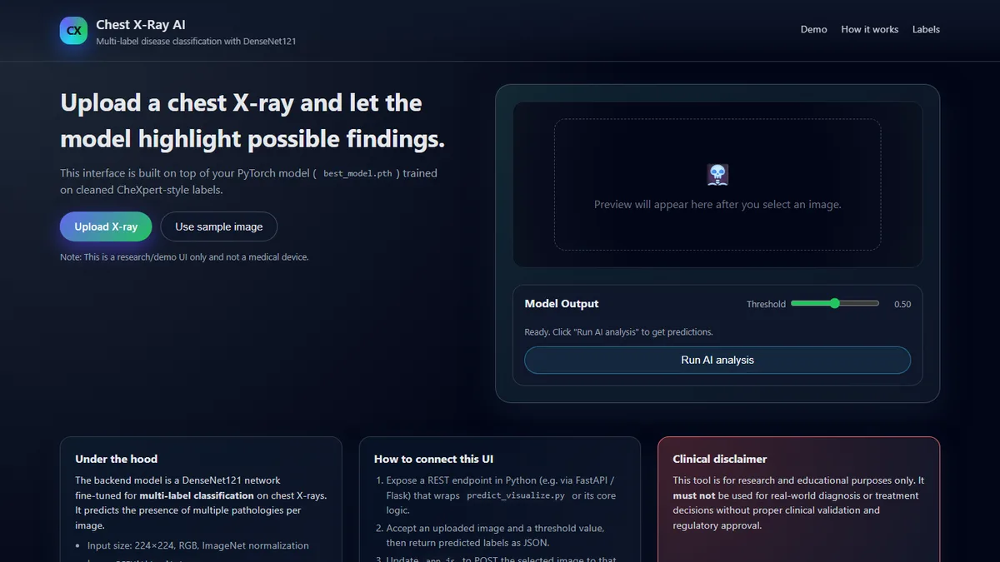

## Chest X-Ray Multi-Label Disease Classification (PyTorch)

<p align="center">
  
</p>

<p align="center">
  <a href="https://chest-x-ray-multi-label-disease.onrender.com/"></a>
  
  <a href="https://www.yashsali.me"></a>
</p>

> ⏳ The demo runs on a free tier and may take ~1 minute to wake up.

This project trains a DenseNet121 model to predict multiple chest X-ray diseases per image using a cleaned labels CSV and a folder of resized images. It supports training, validation, prediction, and visualization with ground-truth comparison.

### Folder Structure
```
project_root/
├── resized/
│   ├── 0001.png
│   ├── 0002.png
│   └── ...
├── labels_clean.csv
├── train_model.py
├── predict_visualize.py
├── best_model.pth         # produced after training
├── class_names.json       # produced after training
└── README.md
```

### Requirements
- Python 3.8+
- PyTorch, TorchVision
- pandas, scikit-learn, Pillow, tqdm, matplotlib

Install (Windows PowerShell):
```powershell
python -m pip install --upgrade pip
pip install torch torchvision torchaudio pandas scikit-learn pillow tqdm matplotlib
```

### Dataset CSV Format
The project supports two CSV formats:
- CheXpert/CheXRay14-like: `Image Index, Finding Labels` with pipe-separated labels
- One-hot columns: `filename,<Atelectasis>...<No Finding>`

Expected labels used by the model (9 total):
```
Atelectasis, Consolidation, Edema, Effusion, Infiltration,
Mass, Nodule, Pneumothorax, No Finding
```

If using `Finding Labels`, any labels outside the list above are ignored. `No Finding` is treated as mutually exclusive if present alone.

### Training
Runs DenseNet121 (ImageNet-pretrained) fine-tuning for multi-label classification.

```powershell
python train_model.py --epochs 10 --batch 32 --lr 1e-4 --val_split 0.1 --workers 0
```

Key flags:
- `--csv`: path to labels CSV (default `labels_clean.csv`)
- `--images`: path to images dir (default `resized`)
- `--out`: output checkpoint path (default `best_model.pth`)
- `--classes_json`: output classes JSON (default `class_names.json`)
- `--epochs`, `--batch`, `--lr`, `--val_split`, `--workers`

What training does:
- Dataset with 224×224 resize, ImageNet normalization, augments (flip, small rotation)
- Model: DenseNet121 with final layer replaced to 9 outputs
- Loss: BCEWithLogitsLoss; Optimizer: Adam
- Validation each epoch, saving the best checkpoint by macro-F1
- Logs: train loss, subset accuracy, per-class F1 and macro-F1

Artifacts:
- `best_model.pth`: best weights (state_dict + metadata)
- `class_names.json`: class order for inference

### Inference
Single-image prediction with optional ground-truth overlay (if CSV provided):

```powershell
python predict_visualize.py "resized\\00000032_000.png" --threshold 0.5
```

Optional flags:
- `--weights best_model.pth`
- `--classes_json class_names.json`
- `--csv labels_clean.csv` (to display ground truth)
- `--threshold 0.5` (probability threshold)

Program flow:
1. Loads model and class names
2. Applies eval transforms (224×224, ImageNet normalization)
3. Outputs predicted diseases with probability ≥ threshold; if none, shows the top-1
4. Displays the X-ray with a caption:
   - `Predicted Diseases: Effusion, Edema`
   - `Actual Labels: Effusion` (if CSV provided)
   - An extra line indicates correctness, missed labels, and false positive

### API Summary
- `ChestXrayDataset` (in `train_model.py`): CSV-driven dataset with transforms
- `build_model(num_classes)`: DenseNet121 with replaced classifier
- `train(...)`: orchestrates loaders, training, validation, metrics, checkpointing
- `predict_diseases(image_path, weights_path, class_names_path, threshold)` (in `predict_visualize.py`)
- `visualize_prediction(image_path, predictions, ground_truth, class_names)` (in `predict_visualize.py`)

### Metrics Reported During Training
- Subset accuracy (exact match of all labels per image)
- Per-class F1 (for each of the 9 classes)
- Macro-F1 (mean of per-class F1)

### Troubleshooting
- Windows DataLoader workers: use `--workers 0` to avoid multiprocessing issues.
- `Missing label columns in CSV`: your CSV likely uses `Image Index, Finding Labels`. The code now supports this. Ensure the image filenames in CSV match those in `resized/`.
- Slow training: lower `--batch`, reduce `--epochs`, or switch to GPU if available.
- Blank visualization window in some IDEs: run from a standard terminal or save the figure in code if needed.

### Notes
- The model uses ImageNet mean/std normalization. Ensure images are 3-channel RGB; grayscale PNGs are converted to RGB in code.
- Threshold tuning can improve precision/recall trade-offs; try 0.3–0.7.

### Example Commands
```powershell
# Train
python train_model.py --epochs 10 --batch 32 --lr 1e-4 --val_split 0.1 --workers 0

# Predict and visualize with ground truth overlay
python predict_visualize.py "resized\\00030350_000.png" --csv labels_clean.csv --threshold 0.5
```


